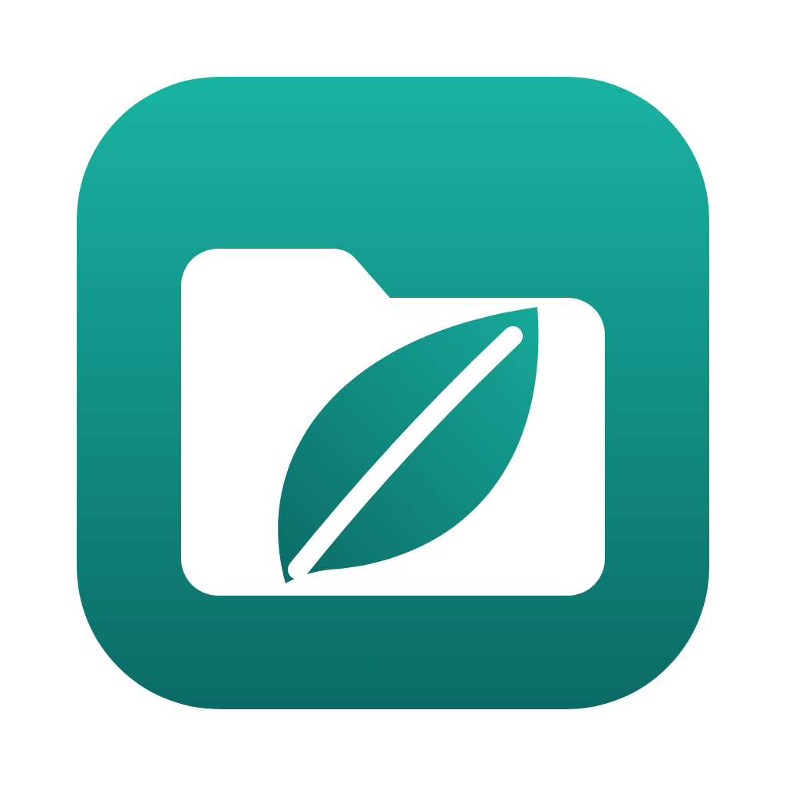

<h1 align="center">
  <br>
  LocalLeaf
</h1>

<p align="center">
  The Overleaf editor as an offline macOS app: open a folder, write LaTeX, compile with your own TeX.
</p>

<p align="center">
  
</p>

LocalLeaf is a native macOS application built from the source code of
[Overleaf Community Edition](https://github.com/overleaf/overleaf). It keeps
Overleaf's editor (the same source and visual editors, PDF viewer, log viewer
and SyncTeX) and removes everything that needs a server. You open a folder on
your Mac and work in it, as you would in TeXstudio:

- files are read from and saved to that folder; nothing is uploaded;
- documents are compiled with **your own TeX installation** (MacTeX or TeX
  Live, through `latexmk`); LocalLeaf does not contain TeX;
- no account, no network connection, no Docker, no database.

> LocalLeaf is an independent project. It is **not affiliated with, endorsed
> by or supported by Overleaf**. Please do not send LocalLeaf questions or bug
> reports to Overleaf. See [Relationship to Overleaf](#relationship-to-overleaf).

## Build and install

```sh
git clone https://github.com/HaiXuan-Lin/LocalLeaf.git
cd LocalLeaf
./build.sh      # builds desktop/dist/LocalLeaf.app from source
./install.sh    # copies it to /Applications
```

You need:

- macOS 13 or later, Apple silicon or Intel, with `git`
  (`xcode-select --install`);
- a TeX distribution with `latexmk` to compile documents:
  [MacTeX](https://www.tug.org/mactex/) or TeX Live;
- an internet connection **while building** (about 1.7 GB of npm packages and
  the Electron runtime are downloaded once) and about 4 GB of free disk space.
  The finished app never uses the network.

`build.sh` uses your Node.js if it is version 24.18 or newer, and otherwise
downloads a private copy into `desktop/.toolchain/`. The first build takes
10–20 minutes, mostly downloading; later builds take a few minutes.

The app is about 280 MB, of which 250 MB is the Electron (Chromium) runtime.
It is signed ad hoc, which is what a locally built app needs on the Mac that
built it; to distribute a build to other people it must be signed with a
Developer ID and notarised.

Options, mirrors for slow connections and uninstalling are described in
[desktop/README.md](desktop/README.md), or run `./build.sh --help` and
`./install.sh --help`.

## Using it

- **Open a folder** with _File ▸ Open Folder…_ (⌘O), from the start page, by
  dropping a folder on the Dock icon, or with `open -a LocalLeaf path/to/folder`.
- **Edit.** Changes are saved to disk automatically. Files changed by another
  program (git, a script, another editor) are picked up while they are open.
- **Compile** with _Recompile_ (⌘S or ⌘↵). `latexmk` runs in the folder of the
  main document, so the PDF and the auxiliary files are where they would be if
  you ran it in a terminal. pdfLaTeX, XeLaTeX, LuaLaTeX and LaTeX are
  available, and a `latexmkrc` in the folder is respected.
- **SyncTeX**: double-click in the PDF to jump to the source, or use the arrow
  buttons between editor and PDF.

The full guide, the list of limitations and a description of how the app works
are in [desktop/README.md](desktop/README.md).

## What is different from Overleaf

Kept: the source and visual editors, autocomplete for commands, references and
citations, spell check, the file tree with upload and drag and drop, the file
outline, project-wide search, the PDF viewer, the log viewer with hints,
SyncTeX, word count, the symbol palette, Vim and Emacs keybindings, editor
themes, the detached PDF window and all interface translations.

Removed, because they need Overleaf's servers or more than one user: accounts
and login, the project dashboard, sharing, real-time collaboration, chat,
comments and track changes, history, templates, the Dropbox, GitHub and
reference-manager integrations, subscriptions, analytics and AI features.

For version history, use git in your folder.

## Relationship to Overleaf

LocalLeaf is a modified version of **Overleaf Community Edition**, the
open-source online LaTeX editor developed by
[Overleaf](https://www.overleaf.com) and published at
<https://github.com/overleaf/overleaf>.

- **Original work:** Overleaf Community Edition, Copyright © Overleaf,
  2014–2025, released under the GNU Affero General Public License, version 3.
- **Version used:** commit
  [`e039ad26c5`](https://github.com/overleaf/overleaf/commit/e039ad26c5bf5422eb57b89fc7e57c75055e631d)
  of 17 September 2026. This repository contains Overleaf's complete git
  history, so every upstream file can be traced to its original commit. The
  current base is recorded in [`desktop/upstream.json`](desktop/upstream.json).
- **Modifications** (first published in November 2026): LocalLeaf adds
  `desktop/`, `services/web/modules/desktop/`, `build.sh`, `install.sh`,
  `NOTICE` and `CITATION.cff`, replaces this `README.md`, and appends a few
  lines to `.gitignore`. No other file of Overleaf is changed in the source
  tree; at build time a short, listed set of front-end modules is swapped for
  desktop versions
  ([`replacements.js`](services/web/modules/desktop/replacements.js)).
  Overleaf's original README is
  [here](https://github.com/overleaf/overleaf/blob/e039ad26c5bf5422eb57b89fc7e57c75055e631d/README.md).
- **Names and logos:** "Overleaf" is a trademark of its owner. LocalLeaf uses
  its own name and its own icon, and Overleaf's logos do not appear in the app.
  The name Overleaf is used here only to say where the code comes from.

The credit for the editor belongs to the Overleaf team and the contributors to
the Overleaf repository. LocalLeaf's own part is the local backend, the
packaging and the adaptation of the interface to a single offline user.

### Citing

If you refer to LocalLeaf in a publication, please cite Overleaf as well.
GitHub's _Cite this repository_ button uses [`CITATION.cff`](CITATION.cff);
in BibTeX:

```bibtex
@software{overleaf,
  author  = {{Overleaf}},
  title   = {Overleaf Community Edition},
  url     = {https://github.com/overleaf/overleaf},
  version = {commit e039ad26c5bf5422eb57b89fc7e57c75055e631d},
  year    = {2026},
  license = {AGPL-3.0}
}

@software{localleaf,
  author  = {Lin, Haixuan},
  title   = {LocalLeaf: the Overleaf editor as an offline macOS application},
  url     = {https://github.com/HaiXuan-Lin/LocalLeaf},
  version = {0.1.0},
  year    = {2026},
  note    = {A modified version of Overleaf Community Edition},
  license = {AGPL-3.0}
}
```

## Keeping up with Overleaf

When Overleaf's editor improves, LocalLeaf can take the improvement by merging
the newer Overleaf:

```sh
desktop/scripts/update-from-overleaf.sh --check   # what would change for LocalLeaf
desktop/scripts/update-from-overleaf.sh           # merge it
./build.sh
```

LocalLeaf's code is kept apart from Overleaf's so that such merges do not
conflict, and a checker reports which of the Overleaf files LocalLeaf depends
on have changed and which new requests, events and extension points the newer
editor has. The procedure is described in
[desktop/UPGRADING.md](desktop/UPGRADING.md).

## License

LocalLeaf is free software under the same license as Overleaf, the
[GNU Affero General Public License, version 3](LICENSE). It comes with no
warranty. If you distribute a build of LocalLeaf, the license requires you to
make the corresponding source code available under the same terms; this
repository is that source for unmodified builds.
