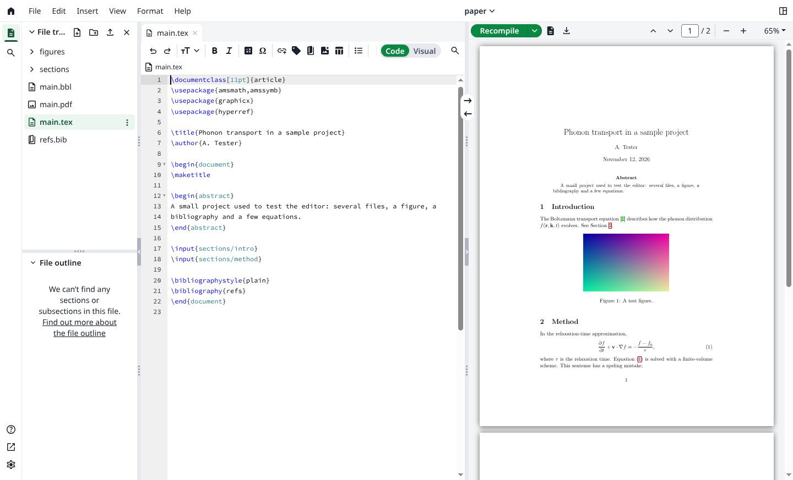

<h1 align="center">
  <br>
  LocalLeaf
</h1>

<p align="center">
  The Overleaf editor as an offline macOS app: open a folder, write LaTeX, compile with your own TeX.
</p>

<p align="center">
  
</p>

LocalLeaf is a native macOS application built from the source code of [Overleaf Community Edition](https://github.com/overleaf/overleaf). It keeps Overleaf's editor (the same source and visual editors, PDF viewer, log viewer and SyncTeX) and removes everything that needs a server. You open a folder on your Mac and work in it, as you would in TeXstudio:

- files are read from and saved to that folder; nothing is uploaded;
- documents are compiled with **your own TeX installation** (MacTeX or TeX Live, through `latexmk`); LocalLeaf does not contain TeX;
- no account, no network connection, no Docker, no database.

> LocalLeaf is an independent project. It is **not affiliated with, endorsed by or supported by Overleaf**. Please do not send LocalLeaf questions or bug reports to Overleaf. See [Relationship to Overleaf](#relationship-to-overleaf).

## Build and install

```sh
git clone https://github.com/HaiXuan-Lin/LocalLeaf.git
cd LocalLeaf
./build.sh      # builds desktop/dist/LocalLeaf.app from source
./install.sh    # copies it to /Applications
```

## Relationship to Overleaf

LocalLeaf is a modified version of **Overleaf Community Edition**, the open-source online LaTeX editor developed by [Overleaf](https://www.overleaf.com) and published at <https://github.com/overleaf/overleaf>.

The credit for the editor belongs to the Overleaf team and the contributors to the Overleaf repository. LocalLeaf's own part is the local backend, the packaging and the adaptation of the interface to a single offline user.

## License

LocalLeaf is free software under the same license as Overleaf, the [GNU Affero General Public License, version 3](LICENSE). It comes with no warranty. If you distribute a build of LocalLeaf, the license requires you to make the corresponding source code available under the same terms; this repository is that source for unmodified builds.
